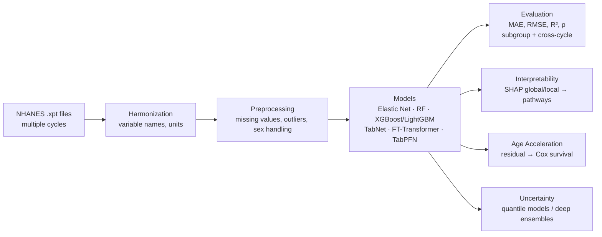

# Biological Age Prediction from Blood Biomarkers

**Interpretable and Generalizable Biological Age Prediction from Routine Blood Biomarkers: Multi-Cohort Evaluation, Uncertainty Quantification, and Pathway-Level Insights**

*By **Shubham N Kambli***

[](https://www.python.org/)
[](https://colab.research.google.com/)
[](https://www.cdc.gov/nchs/nhanes/)
[](#roadmap)
[](LICENSE)

> Predicting chronological age — and more importantly, **who ages faster or slower than expected** — from routine blood biomarkers. A multi-cohort machine learning study with interpretable features, calibrated uncertainty, and validation against mortality outcomes.

---

## 🎯 Motivation

Chronological age is a poor proxy for how old a person biologically is. Two 50-year-olds with identical routine blood work can have vastly different health trajectories. **Biological age** — estimated from measurable physiology — captures this gap, and the *residual* between predicted and chronological age (age acceleration) has been linked to all-cause mortality, frailty, and chronic disease risk.

Most existing "age clocks" are either:

- **Opaque** — black-box models with no link to known aging biology, or
- **Brittle** — trained on one cohort, degraded on another population, with no uncertainty estimates.

This project builds an age prediction pipeline that is **accurate, generalizable across cohorts and demographic subgroups, interpretable at the pathway level, and honest about its own uncertainty** — then tests whether its residuals actually predict mortality.

---

## 🔬 Core Research Questions

| # | Question |
|---|----------|
| 1 | Can modern tabular ML models predict chronological age from routine blood biomarkers with high accuracy **and** good generalization across NHANES cycles and demographic subgroups? |
| 2 | Which biomarkers drive the predictions, and do they map onto known **hallmarks of aging** (inflammation, metabolic dysfunction, kidney/liver function, hematologic changes)? |
| 3 | Does the residual (**Predicted BioAge − Chronological Age**) capture accelerated/decelerated aging that associates with **mortality** or health outcomes? |
| 4 | Can we provide **reliable uncertainty estimates** for individual predictions? |

These four questions combine into a contribution that goes well beyond a standard "age prediction" benchmark — it is structured as a portfolio piece or conference/workshop paper.

---

## 📊 Data

**Primary source: [NHANES](https://www.cdc.gov/nchs/nhanes/) (National Health and Nutrition Examination Survey, CDC) — fully public, Colab-friendly.**

| Component | Details |
|-----------|---------|
| Cycles | Multiple cycles, **1999–2018** (temporal train → test splits possible) |
| Biomarkers | ~25–40 markers after cleaning (see below) |
| Demographics | Sex, ethnicity, education, income — for subgroup fairness analysis |
| Outcomes | Linked **mortality** files for several cycles → survival validation |
| Loading | Raw `.xpt` files + pandas, [`biolearn`](https://github.com/biolearn/biolearn) loaders, or cleaned community versions |

**Biomarker panels used:**

- **CBC**: WBC, RBC, hemoglobin, hematocrit, RDW, MCV, MCH, platelets, lymphocytes, neutrophils, monocytes
- **Metabolic / chemistry**: glucose, HbA1c, creatinine, BUN, uric acid, albumin, total protein, ALP, ALT, AST, GGT, calcium, phosphorus, sodium, potassium, chloride, CO2
- **Lipids**: total cholesterol, HDL, LDL, triglycerides
- **Inflammation**: CRP / hs-CRP
- **Thyroid & hormones**: TSH, T3/T4 (where available by cycle)

*Alternative / extension datasets (optional):* UK Biobank processed subsets, GEO methylation/RNA-seq cohorts, circulating proteomics studies (e.g., deCODE, UKB-PPP subsets).

---

## 🏗️ Methodology



### 1. Data harmonization
Consistent variable names, units, and detection limits across NHANES cycles; documented inclusion/exclusion criteria for each marker.

### 2. Preprocessing
- Missing-value handling (median / KNN / model-based imputation, with missingness analyzed as a potential signal)
- Outlier treatment (winsorization at pre-registered percentiles)
- Sex handled both as a feature and via sex-stratified models (compared explicitly)

### 3. Models

| Tier | Models |
|------|--------|
| Strong baselines | Elastic Net, Random Forest, XGBoost / LightGBM |
| Modern tabular | TabNet, FT-Transformer, TabPFN (if memory allows) |
| Classic clocks (**baselines**) | PhenoAge, KDM Age (via `biolearn`) |
| Optional | Simple MLP / ResNet-style tabular network |

### 4. Evaluation
- **Metrics**: MAE, RMSE, R², Pearson & Spearman correlation
- **Stratified by**: sex, ethnicity, age decade
- **Cross-cycle generalization**: train on earlier cycles → test on later cycles (and vice versa)

### 5. Interpretability
SHAP (global + local), feature importance ranked and **mapped to aging pathways**: inflammaging (CRP, WBC), metabolic dysfunction (glucose, HbA1c, triglycerides), renal function (creatinine, BUN), liver function (ALT, AST, GGT, albumin), hematologic aging (RDW, lymphocytes).

### 6. Biological age acceleration
Residual = Predicted BioAge − Chronological Age, residualized for covariates. Association with **all-cause mortality** via Cox proportional-hazards models on NHANES linked mortality files.

### 7. Uncertainty quantification
Quantile regression forests / gradient boosting quantiles, or deep ensemble variance → prediction intervals with empirical coverage checks (who can we *not* confidently age?).

### 8. Reproducibility
Config-driven code, fixed random seeds, explicit train/val/test splits, one-command reruns.

---

## 📁 Repository Structure

```
Biological-Age-Prediction-from-Blood-Biomarkers/
├── README.md
├── LICENSE
├── requirements.txt
├── configs/                  # experiment configs (data, model, seed)
├── src/
│   ├── data/                 # NHANES download + harmonization loaders
│   ├── preprocessing/        # imputation, outliers, splits
│   ├── models/               # baselines, GBDT, tabular deep models
│   ├── evaluation/           # metrics, subgroup & cross-cycle eval
│   ├── interpretability/     # SHAP, pathway mapping
│   └── analysis/             # age acceleration, Cox survival, UQ
├── notebooks/
│   └── 01_full_pipeline.ipynb   # Colab-ready end-to-end notebook
├── results/                  # metrics tables, figures
└── tests/
```

> 🚧 Code and notebooks are being organized for release — see [Roadmap](#roadmap).

---

## 🚀 Getting Started

### Option A — Google Colab (recommended)
```python
!git clone https://github.com/NotShubham1112/Biological-Age-Prediction-from-Blood-Biomarkers.git
%cd Biological-Age-Prediction-from-Blood-Biomarkers
!pip install -r requirements.txt
```

### Option B — Local setup
```bash
git clone https://github.com/NotShubham1112/Biological-Age-Prediction-from-Blood-Biomarkers.git
cd Biological-Age-Prediction-from-Blood-Biomarkers
python -m venv .venv && source .venv/bin/activate   # Windows: .venv\Scripts\activate
pip install -r requirements.txt
```

### Core dependencies
`pandas`, `numpy`, `scikit-learn`, `xgboost`, `lightgbm`, `shap`, `lifelines`, `optuna`, `biolearn`, `matplotlib`, `seaborn`

---

## 📈 Expected Results (preview)

| Setting | Target metric |
|---------|---------------|
| Within-cycle (random split) | MAE ≤ 4.5 years, R² ≥ 0.85 |
| Cross-cycle (train 1999–2012 → test 2013–2018) | MAE ≤ 5.5 years |
| Age acceleration → mortality | HR > 1 per +5 y acceleration (Cox, p < 0.05) |
| Uncertainty | 90% prediction intervals with ≥ 85% empirical coverage |

*Targets will be replaced with actual results as experiments complete.*

---

## 🗺️ Roadmap

- [ ] NHANES multi-cycle download + harmonization pipeline
- [ ] Preprocessing module (imputation, outliers, splits)
- [ ] Baselines: Elastic Net, Random Forest, XGBoost/LightGBM
- [ ] Classic clock baselines: PhenoAge, KDM (`biolearn`)
- [ ] Modern tabular models: TabNet, FT-Transformer, TabPFN
- [ ] Optuna hyperparameter search (Optuna-friendly entry points)
- [ ] Subgroup + cross-cycle evaluation tables
- [ ] SHAP interpretability + pathway mapping figures
- [ ] Age acceleration → mortality (Cox) validation
- [ ] Uncertainty quantification + coverage calibration
- [ ] End-to-end Colab notebook + paper draft

---

## 📚 Key References

1. Levine, M. E. et al. *An epigenetic biomarker of aging for lifespan and healthspan.* **Aging** (2018). *(PhenoAge)*
2. Klemera, P. & Doubal, S. *A new approach to the concept of biological age.* **Mech Ageing Dev** (2006). *(KDM)*
3. Lu, A. T. et al. *DNA methylation GrimAge strongly predicts lifespan and healthspan.* **Aging** (2019).
4. Raditoiu, A. et al. / NHANES-linked mortality documentation, **NCHS**. *(Survival linkage)*
5. Gorishniy, Y. et al. *Revisiting Tabular Deep Learning.* **NeurIPS** (2021). *(TabNet / FT-Transformer context)*

---

## 📜 License

MIT — see [LICENSE](LICENSE).

## 🤝 Contact

**Shubham N Kambli** — open an issue, or reach out via [GitHub](https://github.com/NotShubham1112).

*Built as a research portfolio project — designed to grow into a conference/workshop paper.*
